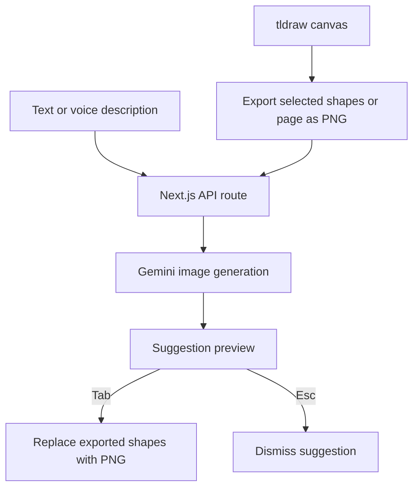

# ChalkAI

Turn a rough sketch and a short explanation into a diagram with Gemini.

[Try the live app](https://chalk-ai.abhishekdev.tech/) · [Watch the demo](#demo) · [Run locally](#run-locally)

Built by [Abhishek Sonje](https://github.com/Abhishek-Sonje) and [Jaydeep](https://github.com/jaydxxp).

ChalkAI combines a tldraw whiteboard with an AI suggestion workflow: draw, describe, generate, review, then accept or reject. Generation happens through a Next.js API route while the canvas remains available.

## Demo

https://github.com/user-attachments/assets/69496cf1-7e2d-4a32-bc0d-b29b8c92ade3

## Features

- **Interactive canvas:** freehand drawing, shapes, arrows and selection through tldraw.
- **Sketch and text input:** send a sketch with an explanation, or generate from a text prompt.
- **Selection-aware generation:** export selected shapes, or the current page when nothing is selected.
- **Preview before accepting:** inspect the generated image before replacing the exported shapes.
- **Keyboard controls:** `Tab` accepts a suggestion; `Esc` dismisses it.
- **Voice input:** browser speech recognition provides another way to describe an idea.
- **Account access:** Clerk protects the board and API routes.
- **Bring your own key:** configure a Gemini key through the board settings.

Generated diagrams are PNG images placed on the canvas, rather than editable vector shapes.

## Run locally

Requirements: **Node.js 20.9+**, npm, [Clerk credentials](https://dashboard.clerk.com/) and a [Gemini API key](https://aistudio.google.com/app/apikey) with access to the configured image model.

```bash
git clone https://github.com/Abhishek-Sonje/ChalkAI.git
cd ChalkAI/frontend
npm install
```

Create `frontend/.env.local`:

```dotenv
NEXT_PUBLIC_CLERK_PUBLISHABLE_KEY=your_clerk_publishable_key
CLERK_SECRET_KEY=your_clerk_secret_key
```

```bash
npm run dev
```

Open [localhost:3000](http://localhost:3000), sign in, open the board and connect your Gemini key in the key settings.

The API route also accepts `GOOGLE_GENERATIVE_AI_API_KEY` as a server fallback. The current board still prompts users to connect their own key. The image model is set in the route to `gemini-2.5-flash-image`; `GEMINI_MODEL` is not read by the current implementation.

## Try the workflow

1. Draw a simple flow, such as a user logging into an application.
2. Select the shapes you want to refine, or leave the selection empty to use the page.
3. Enter a description and press the generate button, or use Quick Enhance.
4. Review the image in the suggestion panel.
5. Press `Tab` to replace the exported shapes, or `Esc` to keep the original.

Voice input requires a browser with speech recognition support and microphone access. Typed prompts work independently of voice support.

## Architecture



| Layer | Technology and role |
| --- | --- |
| Application | Next.js App Router, React and TypeScript |
| Canvas | tldraw editor, selection export and image assets |
| Generation | Vercel AI SDK and Google Gemini |
| Authentication | Clerk |
| Interface | Tailwind CSS and Framer Motion |

## Code map

| Location | Responsibility |
| --- | --- |
| [frontend/components/board-client.tsx](frontend/components/board-client.tsx) | Prompt submission, voice input, loading and suggestion state |
| [frontend/components/whiteboard.tsx](frontend/components/whiteboard.tsx) | Canvas export and image replacement |
| [frontend/app/api/complete-diagram/route.ts](frontend/app/api/complete-diagram/route.ts) | Gemini request and image response |
| [frontend/components/api-key-provider.tsx](frontend/components/api-key-provider.tsx) | Browser key storage and settings state |
| [frontend/proxy.ts](frontend/proxy.ts) | Route authentication |
| [frontend/app/board/page.tsx](frontend/app/board/page.tsx) | Board page |

## Generation endpoint

`POST /api/complete-diagram` requires an authenticated session.

```json
{
  "prompt": "A flowchart showing a user logging in",
  "image_data": "optional_base64_encoded_png"
}
```

Send a user key in the `x-gemini-api-key` header, or configure the server fallback.

Successful response:

```json
{
  "image_data": "base64_encoded_generated_image"
}
```

The route returns an error when credentials or a prompt are missing, generation fails, or the model returns no image.

## Development commands

Run these from `frontend/`:

| Command | Purpose |
| --- | --- |
| `npm run dev` | Start the development server |
| `npm run lint` | Run ESLint |
| `npm run build` | Build standalone output and copy its static assets |
| `npm run start` | Start the standalone server after building |

The build script uses Unix `cp` commands. On Windows, use WSL or a compatible shell for that script.

## Data handling and limitations

- The browser stores a connected Gemini key in local storage and sends it to the application server for API requests.
- Prompts and exported sketches are sent to Gemini for generation.
- Image output may change labels or interpret a sketch incorrectly; review each suggestion.
- Generation depends on model access, quota and provider availability.
- Voice recognition support varies by browser.
- This repository does not currently include an automated test suite.

See [the setup guide](frontend/SETUP.md) for a compact checklist.
